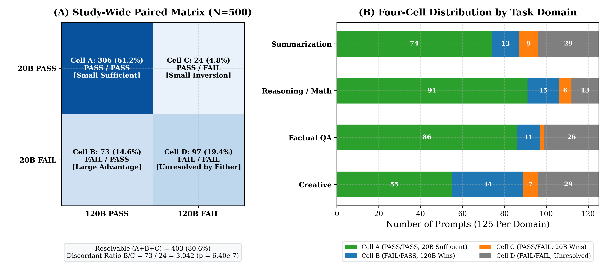
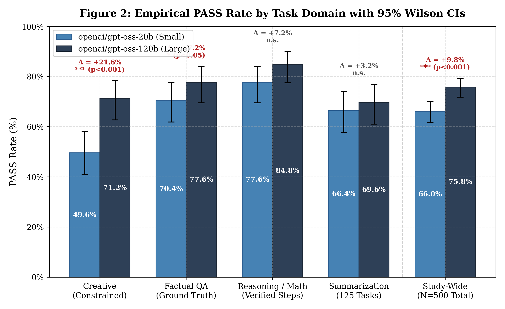
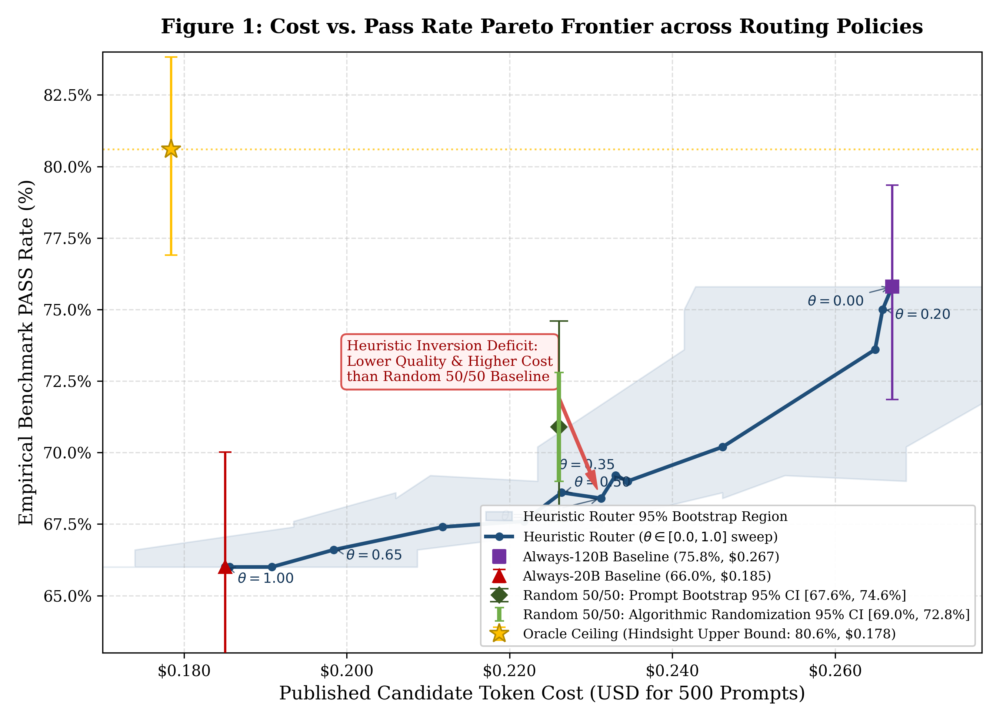

# Empirical Evaluation of LLM Routing Between Parameter-Scaled Models Across Task Domains

[](scripts/test_phase4_regression.py)
[-blue)](data/evaluations/)
[-success)](data/human_validation_results.json)
[](LICENSE)
[](#licensing--data-governance)

## Overview

Dynamic routing between language models of disparate parameter scales (e.g., a "small" ~20B model vs. a "large" ~120B model) is widely proposed as a strategy to reduce inference costs while preserving frontier task performance. Most theoretical routing formulations assume that task difficulty can be estimated *a priori* using heuristic query features (e.g., prompt length, lexical reasoning markers, domain categorization) and that small models reliably suffice for "simpler" tasks.

This study conducts an empirical evaluation of heuristic LLM routing between **`openai/gpt-oss-20b`** (20B parameters) and **`openai/gpt-oss-120b`** (120B parameters) across **500 diverse prompt tasks** drawn from the LMSYS Chatbot Arena benchmark. Responses are evaluated deterministically using **`qwen/qwen3.8-27b`** at $T=0.0$ under pre-specified, category-tailored PASS/FAIL rubrics and verified through a 64-judgment blinded human calibration study.

A complete thesis results and discussion chapter is archived at [`docs/thesis_results_chapter.md`](docs/thesis_results_chapter.md).

---

## Core Research Questions

1. **Marginal Capability Gain**: Across broad task categories, how frequently does the 120B parameter model rescue a failure of the 20B model, and conversely, how often does small-model capability inversion occur?
2. **Heuristic Router Efficacy**: Does a static difficulty-based router based on domain priors, prompt length density, and reasoning complexity outperform naive random routing or achieve Pareto-dominant cost-quality trade-offs?
3. **Domain Prior Inversion**: How do empirical domain-level small-model success rates compare against researcher-specified heuristic difficulty rankings?

---

## Benchmark Design & Provenance

- **Sample Size**: Exactly **500 prompts** selected from LMSYS Chatbot Arena conversations (English single-turn user prompts, excluding pure code-generation tasks).
- **Balanced Domains**: Exactly 125 prompts across four distinct task domains:
  - `factual_qa`: Factual question answering with verified ground-truth facts (125 items).
  - `reasoning_math`: Multi-step mathematical calculations and logical deduction with verified reference solutions (125 items).
  - `summarization`: Passage summarization split into 50 independent reference summaries and 75 assisted reference summaries with 3–5 indispensable key aspects (125 items).
  - `creative`: Constrained creative generation evaluated against a standardized 4-part qualitative rubric (125 items).
- **Candidate Models**:
  - Small: `openai/gpt-oss-20b` ($T=0.0$, `max_tokens=4096`, `tools=None`).
  - Large: `openai/gpt-oss-120b` ($T=0.0$, `max_tokens=4096`, `tools=None`).
- **Evaluator**: `qwen/qwen3.8-27b` ($T=0.0$, `max_tokens=1024`, verdict-first parsing) accessed via Groq API.
- **Frozen Benchmark Provenance (SHA-256)**:
  - `data/prompts.json`: `a9214823cb8fdc0586f5fb2fb88ac29eeebbdf7d7b70da318be495eae8b8ce03`
  - `data/references.json`: `b1531df0fac52057da5b70e2279fc87eb6475236d194234775fae1231b79e9f3`
  - `data/prompts_manifest.json`: `45d927529bab7e09dd18e536c64ea52bd84bd7f415dd506827f9f863c19d90f5`
- **Candidate Evaluations**: Exactly 1,000 evaluations finalized on disk (500 20B + 500 120B), comprising 951 evaluated by the Qwen judge and 49 candidate-side terminal failures (40 auto-FAIL empty/HTTP-400 responses + 9 degenerate outputs handled as candidate FAILs), with zero unresolved evaluator errors.

---

## Pre-Evaluation Validation & Audit

1. **Inter-Rater Reliability (Cohen's Kappa $\kappa$)**:
   - Blinded human validation was conducted across 32 prompts $\times$ 2 candidate models = **64 validation judgments**.
   - **Strict Rubric**: 64 / 64 agreement (**100.0%**), Cohen's $\kappa = \mathbf{1.0000}$.
   - **Charitable Sensitivity Variant**: 62 / 64 agreement (**96.9%**), Cohen's $\kappa = \mathbf{0.9036}$.
   - Evaluator case finding (`84fa8433...`) confirmed that Qwen evaluates factual QA strictly on factual accuracy and does not penalize tail repetition; this finding is documented as a rubric design limitation, with main-study records frozen under the candidate degeneracy protocol.
2. **Terminal Failure Accounting**:
   - 20B terminal failures: 38 empty-text completions (hit 4,096 completion limit emitting whitespace), 2 tool-use HTTP 400 rejections, 8 confirmed repetitive degeneracies (`CANDIDATE_DEGENERATE`). Total = 48 (9.6%).
   - 120B terminal failures: 1 confirmed repetitive degeneracy (`CANDIDATE_DEGENERATE`, prompt `97ec5b57...`). Total = 1 (0.2%).
3. **Cost Model Accounting**:
   - Published Groq rates:
     - 20B: \$0.075 / 1M prompt tokens, \$0.300 / 1M completion tokens.
     - 120B: \$0.150 / 1M prompt tokens, \$0.600 / 1M completion tokens.
   - Aggregate Candidate Published Cost: \$0.18506 (20B) + \$0.26701 (120B) = **\$0.45207**.
   - Actual marginal cash outlay: **\$0.00** (executed within Groq developer tier free quota).

---

## Key Experimental Findings

### 1. Four-Cell Paired Performance Matrix ($N = 500$)

| Cell | 20B Verdict | 120B Verdict | Count ($N=500$) | Percentage | Semantic Role |
| :--- | :---: | :---: | :---: | :---: | :--- |
| **Cell A** | PASS | PASS | **306** | 61.2% | Small model sufficiency (cost saving, quality parity) |
| **Cell B** | FAIL | PASS | **73** | 14.6% | Large model capability advantage (rescue of small failure) |
| **Cell C** | PASS | FAIL | **24** | 4.8% | Small model capability inversion (120B failure) |
| **Cell D** | FAIL | FAIL | **97** | 19.4% | Unresolved by either evaluated model under strict rubric |

- **Resolvable Subspace ($A + B + C$)**: 403 / 500 (80.6%).
- **Concordant Subspace ($A + D$)**: 403 / 500 (80.6%). *(Note: Concordant prompts and resolvable prompts share the count of 403 coincidentally in this sample because $B + C = 73 + 24 = 97 = D$.)*
- **Discordant Ratio ($B / C$)**: 73 / 24 = **3.042** (120B is 3x more likely to rescue 20B than to invert).
- **Study-Wide Paired Significance**: McNemar's exact two-sided test $p = \mathbf{6.405 \times 10^{-7}}$ ($\chi^2 = 23.75$), confirming a statistically significant overall performance advantage of +9.8 percentage points for the 120B model (75.8% vs. 66.0%).



### 2. Category-Specific Model Performance & BH-FDR Significance

| Category | 20B PASS ($k/125$) | 120B PASS ($k/125$) | Delta ($\Delta P$) | Cell A | Cell B | Cell C | Cell D | McNemar Exact $p$ | BH-FDR $q$ | Significant ($\alpha=0.05$) |
| :--- | :---: | :---: | :---: | :---: | :---: | :---: | :---: | :---: | :---: | :---: | :---: |
| **Creative** | 62 (49.6%) | 89 (71.2%) | **+21.6%** | 55 | 34 | 7 | 29 | $2.53 \times 10^{-5}$ | $1.01 \times 10^{-4}$ | **Yes** (120B dominates) |
| **Factual QA** | 88 (70.4%) | 97 (77.6%) | **+7.2%** | 86 | 11 | 2 | 26 | $0.0225$ | $0.0449$ | **Yes** (120B dominates) |
| **Reasoning / Math** | 97 (77.6%) | 106 (84.8%) | **+7.2%** | 91 | 15 | 6 | 13 | $0.0784$ | $0.1045$ | No |
| **Summarization** | 83 (66.4%) | 87 (69.6%) | **+3.2%** | 74 | 13 | 9 | 29 | $0.5235$ | $0.5235$ | No |

*Methodological Guardrail*:
> **"The observed category PASS-rate ordering differs substantially from the researcher-specified router priors, and this difference persists after decomposing candidate-terminal failures from evaluator-scored outputs."**

- Small model success ordering: $\text{Reasoning/Math (77.6\%)} > \text{Factual QA (70.4\%)} > \text{Summarization (66.4\%)} > \text{Creative (49.6\%)}$.
- Heuristic router assumed difficulty ordering: $\text{Creative (0.20)} < \text{Factual QA (0.40)} < \text{Summarization (0.60)} < \text{Reasoning/Math (0.80)}$.



### 3. Fixed Baselines vs. Heuristic Router

| Strategy | Pass Rate ($k/500$) | Uncertainty Interval | Published Token Cost | Cost Savings vs 120B | Quality Retention vs 120B |
| :--- | :---: | :---: | :---: | :---: | :---: |
| **Always-120B** ($\theta = 0.0$) | 75.8% (379/500) | 95% Wilson: [71.9%, 79.3%] | \$0.26701 | 0.00% | 100.00% |
| **Always-20B** ($\theta = 1.0$) | 66.0% (330/500) | 95% Wilson: [61.7%, 70.0%] | \$0.18506 | 30.69% | 87.07% |
| **Random 50/50 Baseline** | 70.9% (354.5/500)| Algorithmic 95% CI: [69.0%, 72.8%]<br>Prompt Bootstrap 95% CI: [67.6%, 74.6%] | \$0.22604 | 15.35% | 93.54% |
| **Heuristic Router ($\theta = 0.45$)** | 68.4% (342/500) | 95% Wilson: [64.2%, 72.3%] | \$0.23124 | 13.40% | 90.24% |
| **Oracle (Hindsight Upper Bound)** | **80.6% (403/500)** | 95% Wilson: [76.9%, 83.8%] | **\$0.17844** | **33.17%** | **106.33%** |

*Core Insight*: The static heuristic router at equal traffic split ($\theta = 0.45$) underperforms a naive Random 50/50 baseline by -2.5 percentage points in observed pass rate while costing more (\$0.23124 vs. \$0.22604). Because the heuristic router's priors inverted empirical domain difficulty, it systematically routed hard creative tasks to the weak model and simple math tasks to the expensive model. This comparison is descriptive rather than a formal hypothesis test, serving as evidence of observed heuristic underperformance on this benchmark rather than proof of statistically significant inferiority.



### 4. Non-Parametric Bootstrap Pareto Analysis (1,000 Resamples)

Across 1,000 bootstrap resamples (seed 42, paired outcomes preserved within each resample), cost savings is computed paired within each replicate relative to that replicate's own 120B baseline cost:
- $\theta = 0.00$: Pass Rate 75.9% [72.2%, 79.8%], Cost \$0.26679, Paired Savings 0.00% [0.00%, 0.00%]
- $\theta = 0.35$: Pass Rate 69.1% [65.0%, 73.2%], Cost \$0.23441, Paired Savings 12.11% [6.94%, 16.99%]
- $\theta = 0.45$: Pass Rate 68.5% [64.4%, 72.6%], Cost \$0.23124, Paired Savings 13.28% [7.46%, 18.90%]
- $\theta = 0.50$: Pass Rate 68.7% [64.6%, 72.8%], Cost \$0.22644, Paired Savings 15.08% [9.35%, 20.60%]
- $\theta = 0.65$: Pass Rate 66.7% [62.6%, 71.0%], Cost \$0.19841, Paired Savings 25.58% [19.58%, 30.66%]
- $\theta = 0.75$: Pass Rate 66.1% [62.0%, 70.4%], Cost \$0.18557, Paired Savings 30.39% [24.82%, 35.54%]
- $\theta = 1.00$: Pass Rate 66.1% [62.0%, 70.4%], Cost \$0.18502, Paired Savings 30.59% [24.96%, 35.67%]

### 5. Summarization Split Sensitivity Analysis (50 Independent vs 75 Assisted)

- **Independent References (n=50)**: 20B Pass = 42/50 (84.0%), 120B Pass = 41/50 (82.0%), $\Delta = -2.0\%$, McNemar $p = 1.0000$.
- **Assisted References (n=75)**: 20B Pass = 41/75 (54.7%), 120B Pass = 46/75 (61.3%), $\Delta = +6.7\%$, McNemar $p = 0.2668$.
- **Between-Group Comparison**:
  - 20B pass rate difference (Independent vs Assisted): Fisher's exact $p = 0.0009$ (Odds Ratio = 4.354).
  - 120B pass rate difference (Independent vs Assisted): Fisher's exact $p = 0.0172$ (Odds Ratio = 2.872).
- **Substantive Finding**: Key aspect constraints significantly lowered the absolute pass rates of both models symmetrically (~21–29%). However, paired McNemar comparisons remained non-significant in both subsets ($p=1.0000$ and $p=0.2668$), providing no empirical evidence that the inclusion of explicit key aspects systematically favored the larger parameter-scaled model.

---

## Repository Structure

```
llm-routing-study/
├── data/
│   ├── prompts.json                       # 500 prompts with difficulty scores (frozen SHA-256)
│   ├── references.json                    # Category-specific references & criteria (frozen SHA-256)
│   ├── prompts_manifest.json             # Provenance manifest (frozen SHA-256)
│   ├── public_benchmark_manifest.json     # LMSYS-compliant redistribution manifest
│   ├── responses/                         # 1,000 raw candidate responses (500 20B + 500 120B)
│   ├── evaluations/                       # 1,000 evaluated JSON records (Qwen + terminal records)
│   ├── human_validation_results.json     # Full 64-judgment human validation ledger
│   ├── phase3_final_audit_report.json    # Pre-Phase 4 audit report
│   └── phase4_statistical_results.json   # Full Phase 4 statistical test results & bootstrap data
├── docs/
│   └── thesis_results_chapter.md         # Comprehensive thesis results and discussion chapter
├── figures/
│   ├── figure1_pareto_frontier.png       # Publication-quality Pareto frontier plot
│   ├── figure2_category_performance.png  # Category-level pass rates with Wilson CIs
│   └── figure3_contingency_and_domains.png# 2x2 contingency matrix and domain breakdown
├── scripts/
│   ├── build_phase2_references.py        # Constructs reference standards
│   ├── run_phase2_candidate_inference.py # Candidate inference orchestration
│   ├── run_phase3_qwen_evaluation.py     # Qwen evaluation execution
│   ├── audit_phase3_completion.py        # 1,000-record integrity verification script
│   ├── run_phase4_statistical_analysis.py# Confirmatory statistical analysis suite
│   ├── test_phase4_regression.py         # 7-point regression verification suite
│   └── generate_thesis_figures.py        # Publication figure generator
├── requirements.txt                      # Minimum package dependencies
└── README.md                             # Comprehensive study documentation
```

---

## Installation & Reproduction Instructions

1. **Install Dependencies**:
   ```bash
   pip install -r requirements.txt
   ```

2. **Verify Integrity of Frozen Assets**:
   ```bash
   python scripts/audit_phase3_completion.py
   ```
   Ensures all 1,000 evaluations match frozen SHA-256 hashes with zero unparseable or error records.

3. **Run Full Phase 4 Statistical Analysis**:
   ```bash
   python scripts/run_phase4_statistical_analysis.py
   ```
   Executes four-cell classification, McNemar exact tests, BH-FDR corrections, threshold sweeps, baseline accounting, bootstrap Pareto analysis, and sensitivity splits, outputting to `data/phase4_statistical_results.json`.

4. **Execute Automated 7-Point Regression Tests**:
   ```bash
   python scripts/test_phase4_regression.py
   ```
   Verifies four-cell mapping, disaggregated resolvable metrics, random baseline dual intervals, paired bootstrap savings, and unchanged McNemar results.

5. **Generate Publication Figures**:
   ```bash
   python scripts/generate_thesis_figures.py
   ```
   Saves high-resolution figures to `figures/`.

---

## Licensing & Data Governance

### Software & Evaluation Framework
All original evaluation scripts, statistical analysis routines, figure generation code, and scoring logic in this repository are licensed under the [MIT License](LICENSE).

### Benchmark Prompts & Model Data
- **Benchmark Prompts**: User prompt texts originate from the [LMSYS Chatbot Arena Conversations dataset](https://chat.lmsys.org/) (`lmsys/chatbot_arena_conversations`, train split) and are governed by LMSYS terms of use for academic research.
- **Candidate & Evaluator Outputs**: The 1,000 candidate responses and 1,000 evaluation critique records are open-weights model outputs published strictly for academic reproducibility and non-commercial research verification.
- **Metadata Manifest**: For pipelines preferring pure identifier mapping without text redistribution, [`data/public_benchmark_manifest.json`](data/public_benchmark_manifest.json) provides a metadata-only manifest containing prompt IDs, category labels, word counts, and router feature scores.
